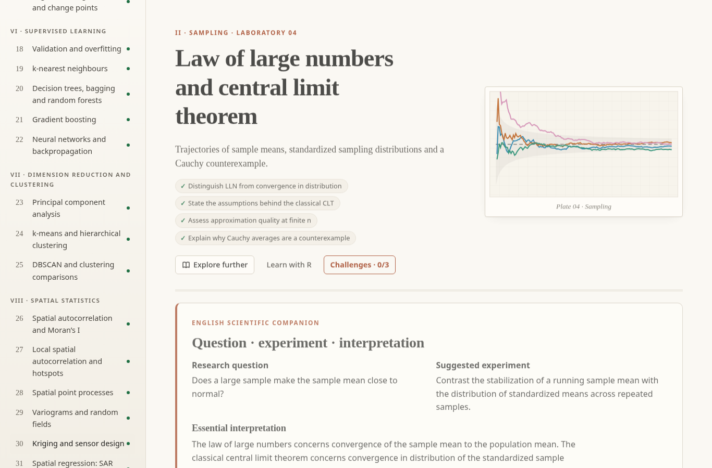

<p align="center">
  
</p>

<h1 align="center">StatAtlas</h1>

<p align="center"><em>See statistics as it happens.</em></p>

<p align="center">
  An interactive atlas of probability, inference, statistical models, machine learning and spatial statistics.<br>
  <strong>31 labs · 93 challenges · 31 R scripts · one HTML file that works offline.</strong>
</p>

<p align="center">
  <a href="https://gianluca-sottile.github.io/statatlas/"><strong>Open StatAtlas</strong></a>
  · <a href="#for-teachers">Teachers</a>
  · <a href="#reproducibility-in-r">R</a>
  · <a href="#development">Development</a>
  · <a href="README.md">Italiano</a>
</p>

## What it is

StatAtlas is an *experiential* learning environment: students make a prediction, change the parameters of an experiment, watch the results and compare them with theory. No server or account is needed.

- **31 labs in eight parts**, from distributions to geostatistics, with two-level theory (*Essentials*, *Advanced*), exercises and references.
- **93 Challenges** (Understanding, Application, Advanced) built on real experimental activity.
- **Reproducible experiments:** controlled seeds, Save/Open JSON, Copy link, and export of the R script for the current experiment.
- **Bilingual IT/EN**, linked to the course [From Data to Models with R](https://gianluca-sottile.github.io/An-R-Tutorial-for-Beginners/).
- **Offline:** `index.html` contains everything; only course links need a connection.

The English edition is a self-contained scientific edition, not a line-by-line translation of every Italian paragraph; some dynamic plot annotations may keep the original terminology.



## The labs

I Probability (01–03) · II Sampling (04–05) · III Inference (06–09) · IV Models (10–13) · V Modern regression (14–17) · VI Supervised learning (18–22) · VII Dimension reduction and clustering (23–25) · VIII Spatial statistics (26–31). The full table is in the [Italian README](README.md#i-laboratori).

Each lab follows *question → prediction → experiment → comparison with theory → interpretation → Reproduce in R*.

## For teachers

- **StatAtlas for Teachers** builds learning paths of 1–24 steps from labs, Challenges and saved configurations. It exports an editable teacher project (JSON) and a standalone student page (HTML). No data is collected online. Guide: [docs/TEACHERS_GUIDA_PRATICA_IT_EN.md](docs/TEACHERS_GUIDA_PRATICA_IT_EN.md).
- **R course materials** (Italian): [teacher guide](docs/MACROFASE_B_GUIDA_DOCENTE.md), [lab–lesson map](docs/MACROFASE_B_MAPPATURA_CORSO.csv), [31 student worksheets](docs/schede_studenti_B/).

## Reproducibility in R

The pseudo-random generator reproduces R's Mersenne–Twister and normal inversion in JavaScript. Every lab exports an R script with the current parameters. All 31 scripts run in GNU R, and labs 01–25 have 84 numerical R/JavaScript comparisons on their default scenarios. See the [formal audit](docs/AUDIT_FORMALE_TEORICO_31.md) and the [verification matrix](docs/MACROFASE_A_MATRICE_VERIFICHE.csv).

Stated limits: LISA quadrants are not local p-values, L(r)−r alone is not a CSR test, the IDW surface carries no kriging variance; automated accessibility checks are not a WCAG certification.

## Development

Plain HTML, CSS and JavaScript, no framework or backend. `build.py` bundles `src/` into the single `index.html`.

```bash
python3 build.py
for f in tests/test_*.js; do node "$f" || exit 1; done
Rscript verifica/valida_tutti_31.R --timeout=900
sh tests/run_macrofase_UX.sh   # full local acceptance (R, Playwright, Node)
```

History: [CHANGELOG.md](CHANGELOG.md).

## Citation and licences

**Author:** Gianluca Sottile, University of Palermo. Metadata: [CITATION.cff](CITATION.cff).

- **Software:** [MIT](LICENSE)
- **Teaching materials:** [CC BY 4.0](https://creativecommons.org/licenses/by/4.0/)
