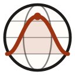

<p align="center">
  
</p>

<h1 align="center">StatAtlas</h1>

<p align="center">
  <em>Vedere la statistica mentre accade.</em><br>
  Un atlante interattivo di probabilità, inferenza, apprendimento statistico e metodi spaziali: trentuno laboratori, dati generati sotto i tuoi occhi e codice R riproducibile, da verificare a ogni estensione.
</p>

<p align="center">
  <a href="https://gianluca-sottile.github.io/statatlas/"><strong>Apri StatAtlas →</strong></a>
  &nbsp;·&nbsp; <a href="#i-laboratori">Laboratori</a>
  &nbsp;·&nbsp; <a href="#come-è-fatto-un-laboratorio">Struttura</a>
  &nbsp;·&nbsp; <a href="#riproducibilità-in-r">Riproducibilità in R</a>
  &nbsp;·&nbsp; <a href="#sviluppo">Sviluppo</a>
</p>

<p align="center">
  
  
  
  
  
</p>

---

## Perché StatAtlas

Molti concetti della statistica — la legge dei grandi numeri, il teorema centrale, la copertura di un intervallo, la potenza di un test — sono affermazioni su **che cosa succede ripetendo un esperimento molte volte**. StatAtlas rende visibile proprio questo: ogni osservazione, ogni campione, ogni intervallo viene generato davanti allo studente, e il risultato si confronta passo dopo passo con ciò che la teoria garantisce.

- **Didattica attiva.** Ogni laboratorio parte da una domanda; chi vuole può fare una previsione *prima* di vedere i dati.
- **Rigore dichiarato.** Ogni risultato teorico è etichettato come *esatto*, *asintotico*, *approssimato* o *Monte Carlo*: non si confonde mai ciò che vale per ogni n con ciò che vale al limite.
- **Stessi numeri in R.** Il generatore di numeri casuali di R è reimplementato nel browser: lo script fornito, con lo stesso seed, riproduce gli stessi campioni. Ogni script dichiara fin dove arriva la corrispondenza (livelli R0–R3) e richiede la verifica eseguibile in R per ogni nuova versione. Le verifiche R dei laboratori 26–31 sono state confermate dall’autore nell’ambito dei batch di sviluppo; i nuovi approfondimenti del presente audit non modificano formule, generatori o algoritmi.
- **Due livelli di lettura.** Un pannello *Approfondisci* con teoria essenziale, derivazioni avanzate, esercizi con soluzione e bibliografia; formule composte tipograficamente e numerate, senza librerie esterne.
- **Nessuna installazione.** Un unico file `index.html`, che funziona anche offline. Nessun server, nessuna libreria esterna.

## Esperienza mobile e tablet

L'interfaccia è adattata ai dispositivi touch senza modificare i motori numerici: sui tablet fino a 1180 px il menu dei laboratori è a scomparsa, mentre sui telefoni è disponibile una barra di navigazione rapida per tornare a **Parametri**, **Grafici**, **Risultati** e **Inizio**. I pulsanti **Avvia**, **Passo**, **Completa** e **Ricomincia** rimangono gli stessi degli esperimenti desktop e, sui dispositivi compatti, compaiono prima della lista dei parametri.

- **Grafici:** pulsante di ingrandimento con bersaglio touch 44 px; su telefono l'ingrandimento mostra un grafico largo e scorrevole orizzontalmente, con comando di chiusura sempre visibile.
- **Approfondimenti:** pannello a tutta larghezza su telefono, con le quattro schede distribuite su due righe e formule scorrevoli quando necessario.
- **Tabelle e codice R:** contenitori con scorrimento orizzontale indipendente; suggerimento visibile solo su telefono per le tabelle.
- **Accessibilità:** menu laterale con chiusura mediante Esc o tocco esterno, stato `aria-expanded`, gestione del focus e rispetto della preferenza di movimento ridotto.

Il bundle resta un singolo `index.html` funzionante senza rete. Per ripetere il collaudo browser (richiede Playwright e Chromium):

```bash
python3 build.py
python3 tests/test_mobile_tablet.py
```

Sono stati testati Chromium desktop emulando viewport da 320, 390, 768 e 1024 px; rimane opportuno un collaudo manuale su Safari iOS/iPadOS reale, incluse rotazioni e gesti tattili.

## I laboratori

| | Laboratorio | Che cosa si esplora |
|---|---|---|
| **I · Probabilità** | 01 · Distribuzioni e relazioni | 17 leggi, densità e ripartizione, banda DKW, superfici 3D, mappa dei legami tra leggi |
| | 02 · Variabili bivariate | Nuvola con marginali, densità 3D, leggi condizionate, il limite della correlazione |
| | 03 · Metodi di simulazione | Metodo di inversione, integrazione Monte Carlo, confronto delle varianze |
| **II · Campionamento** | 04 · Grandi numeri e limite centrale | Traiettorie della media, medie standardizzate, Berry–Esseen, il controesempio di Cauchy |
| | 05 · Adattamento di un modello | QQ plot con banda esatta, test X² con classi corrette, p-value Monte Carlo |
| **III · Inferenza** | 06 · Media, mediana e massima verosimiglianza | Efficienza e robustezza sugli stessi campioni (Normale, Laplace, Cauchy) |
| | 07 · Verosimiglianza e informazione di Fisher | Dieci modelli, identità di Bartlett, Cramér–Rao, Wald contro rapporto di verosimiglianza |
| | 08 · Intervalli di confidenza | Copertura nominale, esatta e osservata: Z, t, Wald, Wilson, Garwood, pivot χ² |
| | 09 · Test e potenza | Errore di primo tipo, curve di potenza, numerosità campionaria |
| **IV · Modelli** | 10 · Regressione interattiva | Punti trascinabili, leverage, distanza di Cook, banda per la media e intervallo di previsione |
| | 11 · Regressione L1, L2, Lp | Criteri di stima a confronto con errori a code pesanti e contaminati |
| | 12 · Modelli lineari generalizzati | Logistica e Poisson, IRLS, distorsione per n piccolo, separazione |
| | 13 · Serie temporali ARMA | ACF e PACF teoriche ed empiriche, radici, stazionarietà e invertibilità |
| **V · Regressione moderna** | 14 · Regressione quantilica | Rette per ogni quantile, perdita asimmetrica, soluzione esatta, punti trascinabili |
| | 15 · Ridge, lasso ed elastic net | Spazio delle soluzioni, percorsi di regolarizzazione, distorsione–varianza |
| | 16 · Regressione non parametrica e spline | Polinomi, spline, P-spline e kernel: basi, gradi di libertà effettivi, validazione incrociata |
| | 17 · Regressione segmentata e breakpoint | Profilo RSS(ψ), breakpoint non identificato, test bootstrap dell’esistenza del cambiamento |
| **VI · Apprendimento supervisionato** | 18 · Validazione e overfitting | Training, test e validazione incrociata a K fold, ottimismo della scelta sul test |
| | 19 · k vicini più prossimi | Frontiere di decisione, errore di Bayes e limite di Cover–Hart, scelta di k, standardizzazione |
| | 20 · Alberi, bagging e random forest | Instabilità di un albero, bootstrap ed errore out-of-bag, decorrelazione con mtry |
| | 21 · Gradient boosting | Alberi sequenziali su residui e pseudo-residui, shrinkage, perdita e early stopping |
| | 22 · Reti neurali e backpropagation | Rete 2–H–1, forward pass, backpropagation e gradient checking |
| **VII · Riduzione dimensionale e clustering** | 23 · Componenti principali | Assi di massima varianza, scree plot, biplot, ricostruzione, stabilità degli assi (asintotica di Anderson) |
| | 24 · k-means e clustering gerarchico | Lloyd passo dopo passo, minimi locali e riavvii, dendrogrammi e legami, indice di Rand corretto |
| | 25 · DBSCAN e confronto tra metodi | Core, bordo e rumore, k-distanze e scelta di ε, lune e cerchi contro k-means e Ward |
| **VIII · Statistica spaziale** | 26 · Autocorrelazione spaziale e Moran | Modifica interattiva dei territori, pesi rook/queen, Moran scatterplot, distribuzione permutazionale e trend |
| | 27 · Autocorrelazione locale, hotspot e MAUP | Moran locale, quadranti LISA, test permutazionali condizionali, BH/BY e MAUP |
| | 28 · Processi puntuali spaziali | Poisson omogeneo e non omogeneo, Thomas, inibizione, K/L di Ripley, envelope CSR e test globale |
| | 29 · Variogrammi e campi aleatori spaziali | Covarianza, anisotropia, nugget, coppie di sensori e variabilità Monte Carlo del variogramma |
| | 30 · Kriging e disegno dei sensori | Simple/ordinary kriging, IDW, collocazione dei sensori e mappa dell’incertezza |
| | 31 · Regressione spaziale e validazione geografica | OLS, SAR, SEM, impatti e random/spatial block cross-validation |

## Come è fatto un laboratorio

Ogni laboratorio segue la stessa sequenza, così lo studente impara un’unica interfaccia:

1. **Domanda** — un problema concreto da cui partire, con una *previsione facoltativa*: chi vuole mettersi alla prova annota che cosa si aspetta e riceve un riscontro a simulazione avanzata.
2. **Esperimento** — una guida specifica «Come usare il laboratorio» propone quattro mosse; controlli per seed, numerosità e velocità, avvio, pausa e un passo alla volta. Un riquadro spiega *che cosa stiamo valutando*.
3. **Teoria e simulazione a confronto** — una tabella con il valore teorico, quello simulato e la natura del risultato.
4. **Interpretazione** — che cosa significa, quando vale, dove si rompe.
5. **Approfondisci** — Essenziale · Avanzato · Esercizi · Bibliografia.
6. **Codice R** — uno script R che si aggiorna con i parametri scelti; si copia o si scarica.

I dati e le figure si esportano in CSV e PNG.

## Riproducibilità in R

StatAtlas implementa in JavaScript il generatore **Mersenne-Twister** di R, inclusa la procedura di inizializzazione del seed (*scrambling*) di `set.seed()`, e il metodo di **inversione** usato da `rnorm()`. Le altre leggi sono generate come `q*(runif(n), …)`, cioè per inversione della funzione di ripartizione. Di conseguenza, con R ≥ 4.1 e le impostazioni predefinite (`RNGkind("Mersenne-Twister", "Inversion")`):

```r
set.seed(2026)
runif(3)   # gli stessi tre numeri che StatAtlas genera con seed 2026
```

### Livelli di riproducibilità

| Livello | Che cosa coincide | Esempi |
|---|---|---|
| **R0** · stessi dati | Stesso seed, stessi campioni, stesse suddivisioni training/test e fold, stessi campioni bootstrap | tutti i laboratori |
| **R1** · stesse misure | Stesse stime ed errori, a meno dell’arrotondamento | `prcomp` nel lab 23, `lm` con `poly()` nel lab 18 |
| **R2** · stesso algoritmo | Stessi passi e stesse regole nei casi di parità | CART e foreste del lab 20, boosting didattico del lab 21, DBSCAN del lab 25, discesa del gradiente del lab 22, `kmeans(algorithm = "Lloyd")` |
| **R3** · confronto di metodo | Pacchetti che seguono regole diverse: risultati vicini, non identici | `segmented`, `ranger`, `class::knn`, `dbscan`, `nnet` |

Gli script richiedono R ≥ 4.1 e il pacchetto `tidyverse`; alcuni laboratori usano solo funzioni di base di R (`persp`, `glm`, `arima`), i laboratori 14 e 15 anche `quantreg` e `glmnet`, il 17 `segmented`. Anche la suddivisione training/test e i fold del laboratorio 18 coincidono con quelli di R (`sample()`, R ≥ 3.6).

## Uso

- **Online:** apri il sito pubblicato con GitHub Pages.
- **Offline:** scarica `index.html` e aprilo con un browser recente (Chrome, Edge, Firefox, Safari). Funziona anche senza connessione.
- **In aula:** il tema scuro si attiva dalla barra laterale; i grafici si ingrandiscono con la finestra del browser. Tastiera: <kbd>Spazio</kbd> avvia o mette in pausa, <kbd>→</kbd> esegue un passo.

## Sviluppo

Il progetto è scritto in HTML, CSS e JavaScript nativi, senza framework. I sorgenti sono modulari; uno script Python li riunisce nel file unico distribuito.

```
StatAtlas/
├── index.html            ← file distribuito (generato)
├── build.py              ← src/ → index.html
├── src/
│   ├── shell.html
│   ├── styles/           ← design system: token, componenti, strato editoriale
│   ├── core/             ← generatore compatibile con R, leggi, formule (math.js), algebra lineare,
│   │                       ricampionamento, kNN, CART e gradient boosting, clustering, reti neurali, grafici SVG e 3D,
│   │                       componenti, illustrazioni, contenuti e supplementi didattici, navigazione
│   └── labs/             ← un file per laboratorio
├── tests/
│   ├── test_*.js         ← test numerici (generatore, leggi, algebra lineare, ricampionamento, ML, clustering, reti)
│   └── smoke/            ← test di caricamento dei laboratori (jsdom)
├── verifica/             ← script R di verifica automatica contro i valori del browser
└── assets/logo.svg
```

```bash
python3 build.py                                   # ricostruisce index.html
node tests/test_core.js                            # test numerici
node tests/test_linalg.js && node tests/test_resampling.js && node tests/test_ml.js && node tests/test_boost.js && node tests/test_cluster.js && node tests/test_nn.js
npm install jsdom && node tests/smoke/smoke_fase7.js index.html   # smoke test
```

### Verifica degli script R

`verifica/verifica_statatlas.R` esegue in R gli script dei 24 laboratori precedenti e richiama la verifica aggiuntiva del laboratorio 21 con i parametri predefiniti e confronta automaticamente i risultati con quelli del browser (generatore, campioni, stime, errori), stampando un riepilogo e salvando gli esiti in CSV:

```bash
Rscript verifica/verifica_statatlas.R        # tutti i laboratori; controlli storici rinumerati per i lab 17–20 e 22–25, più il lab 21
Rscript verifica/verifica_statatlas_01_16.R  # confronti numerici per i lab 01–16
Rscript verifica/verifica_gradient_boosting.R # confronto JS-R in 3 scenari del lab 21
```

Il file generale si rigenera con `node tests/gen_verifica_R.js` a partire dall’estrazione jsdom; le verifiche autonome si rigenerano con `node tests/gen_boost_reference.js`, `node tests/gen_moran_reference.js`, `node tests/gen_point_reference.js` e `node tests/gen_geostat_reference.js`. Il file generale conserva i dati di riferimento dei precedenti 24 laboratori e riporta i nuovi numeri 22–25; una nuova estrazione completa con jsdom consentirà di rigenerarlo integralmente dal browser.

### Comportamento dei controlli nei laboratori spaziali

Nei LAB 26–29 le simulazioni **non partono automaticamente nemmeno all’apertura**.
Cambiare il meccanismo generatore, i dati, il vicinato o la zonizzazione interrompe
l'eventuale animazione e invalida le repliche Monte Carlo non più confrontabili: il nuovo stato
è subito visibile, ma per avviare una nuova simulazione occorre usare **Avvia**, **Passo**
o **Completa**. Cambiare solamente visualizzazione, alternativa, soglia, correzione
per test multipli o numero B non rigenera i dati e conserva le repliche compatibili.
Quando B diminuisce viene utilizzato il prefisso delle repliche già ottenute; la coda
rimane disponibile in memoria se B viene successivamente aumentato.

### Verifiche

- 397 test numerici superati in JavaScript (319 precedenti + 78 geostatistici LAB 29): generatore (`runif`, `rnorm`), quantili e funzioni di ripartizione (`qnorm`, `pt`, `qbeta`, `qf`, `qgamma`, …) confrontati con R.
- Smoke test dei laboratori storici documentati dalla baseline; per i laboratori 26–29 sono stati collaudati in Chromium/Playwright, inclusi grafici, tabella, navigazione, export e layout mobile.
- Gli script dei 24 laboratori precedenti erano stati verificati in R reale (48 controlli documentati al 13/11/2026); lo script del gradient boosting è stato eseguito dall’autore con esito positivo su tre scenari; gli script R dei LAB 26–28 sono stati verificati dall’autore, compresa la correzione opzionale `spatstat` per LAB 28. **Il LAB 29 e stato verificato in R reale dall’autore; il nuovo LAB 30 richiede ancora il confronto indipendente R sul Mac.**
- Da completare: collaudo su Safari, Firefox e dispositivi mobili.

## Come citare

> Sottile G. (2026). *StatAtlas: un atlante interattivo di probabilità e inferenza statistica*, versione 1.14.0 (baseline; modifica sperimentale non pubblicata). https://github.com/gianluca-sottile/statatlas

## Crediti

Progetto di **Gianluca Sottile**, Università degli Studi di Palermo.

Diversi laboratori traggono ispirazione dalle idee didattiche di **Simul2000** di Marcello Chiodi (Università di Palermo), in particolare l’attenzione al processo di simulazione osservabile. Codice, testi e illustrazioni di StatAtlas sono originali.

## Licenza

- **Codice** (file `.js`, `.css`, `.html`, `.py`): [licenza MIT](LICENSE).
- **Contenuti didattici** (testi, esercizi, illustrazioni): [Creative Commons Attribuzione 4.0 Internazionale (CC BY 4.0)](https://creativecommons.org/licenses/by/4.0/deed.it).

Puoi usare, modificare e ridistribuire StatAtlas, anche nei tuoi corsi, citando l’autore.

## Sviluppo sperimentale — Batch 2, laboratorio 26

La Parte VIII si apre con **LAB 26 — Autocorrelazione spaziale e Moran**, sviluppato sopra `src/core/spatial.js` e `src/core/spatial-areal.js` senza dipendenze JS esterne. Sono disponibili cinque schemi generatori (due blocchi, alternanza, rumore indipendente, trend con errori indipendenti, SAR), possibilità di rimuovere il trend vero in modalità simulata, vicinati rook/queen/per distanza, pesi binari/standardizzati per riga, permutazioni animate, testo metodologico Essenziale/Avanzato, CSV e script R per il campione corrente. Gli ID delle lezioni precedenti non cambiano.

La suite numerica JavaScript è stata eseguita e il confronto indipendente R del LAB 26 è stato successivamente confermato dall'autore. Anche la verifica R del LAB 21 sul gradient boosting ha dato esito positivo per i tre scenari (sine, step, binary). Il collaudo grafico in browser reale è stato completato nei batch successivi.

```sh
python3 build.py
node tests/test_spatial_core.js
node tests/test_spatial_areal.js
node tests/test_moran_mount.js
node tests/gen_moran_reference.js
Rscript verifica/verifica_moran.R
# oppure, nel master con pacchetti R già presenti:
Rscript verifica/verifica_statatlas.R
```


## Sviluppo sperimentale — Batch 3, laboratorio 27

La nuova **lezione 27 — Autocorrelazione locale, hotspot e MAUP** estende la Parte VIII utilizzando `src/core/spatial-local.js`. Comprende quadranti LISA, test locali bilaterali con permutazioni condizionali, correzioni BH/BY, aggregazione da 64 a 16 o 4 unità e modifica dei confini delle zone. Conserva la convenzione grafica standard StatAtlas: copertina SVG, obiettivi, previsione espandibile, guida, animazione e tabelle.

Il motore e il laboratorio sono verificati in JavaScript e con un browser Chromium headless. **Il confronto R del LAB 27 è stato confermato dall’autore:** avviare `source("verifica/verifica_lisa.R")` da R, oppure eseguire `Rscript verifica/verifica_lisa.R` dalla radice del progetto. In alternativa, il master `verifica/verifica_statatlas.R` include il controllo LAB 27. Nessuna dipendenza R è richiesta per il file autonomo del LAB 27.

```sh
python3 build.py
node tests/test_spatial_local.js
node tests/gen_lisa_reference.js
STATATLAS_CHROMIUM=/usr/bin/chromium python3 tests/smoke/smoke_lab27_browser.py
```


## Batch 4 — LAB 28: processi puntuali spaziali (14/11/2026)

- `src/core/spatial-points.js`: processi di Poisson omogeneo e non omogeneo, Thomas, inibizione sequenziale, K translation-corrected, L(r)−r, test globale Monte Carlo condizionale su N, distanza nearest-neighbour e conteggi in quadrati.
- `src/labs/28-processi-puntuali.js`: nuova lezione con SVG, obiettivi, previsione e feedback, esperimento guidato, quattro grafici e tabella, esportazioni, approfondimenti Essenziale/Avanzato, esercizi e bibliografia.
- `tests/test_spatial_points.js`: 65 nuovi controlli numerici JS. `tests/smoke/smoke_lab28_browser.py`: collaudo reale Chromium di grafici, controlli, teoria e mobile.
- `tests/gen_point_reference.js` genera la verifica R indipendente `verifica/verifica_processi_puntuali.R` su quattro configurazioni JS con controlli R1 e confronti metodologici CSR. **Eseguire lo script R prima di certificare il laboratorio.**
- Il master R richiama la nuova verifica; identità e numerazione pubblica dei laboratori 01–27 mantenute.


## Batch 5 — LAB 29: variogrammi e campi gaussiani (14/11/2026)

- Nuovo `src/core/spatial-geostat.js`: campi gaussiani piccoli, covariance esponenziale, gaussiana e sferica, anisotropia geometrica, Cholesky, variogrammi empirici di Matheron, simulazioni Monte Carlo su siti fissi.
- Nuovo `src/labs/29-variogrammi.js` con copertina SVG, obiettivi, previsione, mappa interattiva del campo e dei sensori, selezione di coppie, curve teoriche ed empiriche, istogramma di coppie, bande MC, tabelle, teoria essenziale/avanzata ed esportazioni.
- LAB 26–29: apertura con simulazione ferma e dati/grafici già inizializzati; solo i comandi Avvia/Passo/Completa lanciano nuove repliche.
- 78 controlli JS del LAB 29; test browser `smoke_spatial_controls.py` e `smoke_lab29_browser.py` per interazioni, downloads e mobile.
- Script autonomo `verifica/verifica_variogrammi.R`, generato con `node tests/gen_geostat_reference.js`, quattro scenari JS–R con riferimento deterministico. **Il confronto R deve essere ancora eseguito sul Mac.**

```sh
python3 build.py
node tests/test_spatial_geostat.js
node tests/gen_geostat_reference.js
python3 tests/smoke/smoke_spatial_controls.py
python3 tests/smoke/smoke_lab29_browser.py
Rscript verifica/verifica_variogrammi.R  # eseguire su Mac con R >= 4.1
```


## Batch 6 — LAB 30: kriging e disegno interattivo dei sensori (14/11/2026)

- Nuovo `src/core/spatial-kriging.js`: kriging semplice e ordinario per il campo latente, varianze coerenti con un nugget osservazionale, soluzione Cholesky, IDW come riferimento privo di varianza modellistica.
- Nuovo `src/labs/30-kriging.js`: stesso campo latente fisso durante aggiunta, spostamento e rimozione di sensori; verita' inizialmente nascosta, previsione, mappa dell'incertezza, confronto Monte Carlo e modalita' di modello mal specificato.
- Struttura didattica completa: copertina SVG, obiettivi, previsione a tre opzioni, istruzioni, quattro grafici, tabella, approfondimenti Essenziale/Avanzato, esercizi e bibliografia.
- **Avvio manuale**: nessuna simulazione Monte Carlo automatica all'apertura o dopo modifiche ai parametri. Disponibili Avvia, Passo e Completa.
- Nuovi `tests/test_spatial_kriging.js`, `tests/gen_kriging_reference.js` e `tests/smoke/smoke_lab30_browser.py`. Confronto indipendente R in `verifica/verifica_kriging.R` (cinque scenari), registrato nel master `verifica_statatlas.R`.
- La verifica R del LAB 29 e' stata confermata dall'autore; quella del LAB 30 va ancora eseguita.

```sh
python3 build.py
node tests/test_spatial_kriging.js
node tests/gen_kriging_reference.js
python3 tests/smoke/smoke_lab30_browser.py
Rscript verifica/verifica_kriging.R  # da eseguire sul Mac con R
```


## Batch 7 — LAB 31: regressione spaziale e validazione geografica (14/11/2026)

- Nuovo motore `src/core/spatial-regression.js`: SAR e SEM gaussiani su griglia 6×6 con pesi rook normalizzati; stima ML tramite profilo discreto (33 valori), log-determinante LU e OLS condizionata ottenuta con QR; impatti SAR diretti, indiretti e totali.
- `src/labs/31-regressione-spaziale.js`: simulatore completo nello stile StatAtlas (copertina SVG, obiettivi, previsione, quattro grafici, tabelle, Essenziale/Avanzato, esercizi, R), con confronto fra random CV e spatial block CV per kNN spaziale.
- Nessuna partenza automatica dell'esperimento: la Monte Carlo CV inizia soltanto premendo Avvia, Passo o Completa. Le modifiche puramente grafiche non cancellano le repliche compatibili.
- `tests/test_spatial_regression.js`, `tests/gen_spatial_regression_reference.js`, `tests/smoke/smoke_lab31_browser.py` verificano calcoli e interfaccia.
- `verifica/verifica_regressione_spaziale.R`: cinque scenari indipendenti in R base, integrati nel file master `verifica_statatlas.R`. **LAB 31: verifica R ancora da eseguire dall'autore. LAB 30: verifica R confermata dall'autore il 14/11/2026.** Il confronto con `spatialreg` è metodologico (R3): i suoi ottimizzatori non sono gli stessi della ricerca discreta del simulatore.

```sh
python3 build.py
node tests/test_spatial_regression.js
node tests/gen_spatial_regression_reference.js
python3 tests/smoke/smoke_lab31_browser.py
Rscript verifica/verifica_regressione_spaziale.R
```
