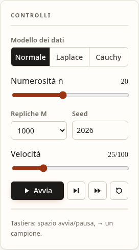

> **Patch bilingue EN — candidate, 18 novembre 2026.** Integrate le traduzioni di etichette, tabelle e grafici generati nei 31 laboratori, incluso quello sulle reti neurali; aggiornati i collegamenti del footer. Motori statistici e script R invariati. Richiesto nuovo collaudo Mac della build aggiornata prima della pubblicazione. [Audit e protocollo](docs/EN_SURFACE_PATCH_31.md).

> **Rifinitura UX — candidate locale, 18 novembre 2026.** La precedente versione UX ha superato il collaudo completo sul Mac (SHA HTML `f01c3810…`) e lo studente dispone del percorso E. Questa nuova candidate riordina la barra di tutti i 31 laboratori in **Guida · Approfondisci · Mettiti alla prova | Corso R · Codice R | Salva/Condividi**, con bordi uniformi e pannelli sovrapposti per Challenges e codice R. Il comando ridondante «Simula» è rimosso dalla barra, non dai simulatori. I 31 script R e i 25 riferimenti numerici R1 rimangono identici; i gate GNU R devono essere ripetuti sul nuovo fingerprint prima del push. [Rapporto della rifinitura](docs/UX_TOOLBAR_REFINEMENT.md). La Macrofase F Classroom resta soltanto in roadmap.

<p align="center">
  
</p>

<h1 align="center">StatAtlas</h1>

<p align="center"><em>Vedere la statistica mentre accade.</em></p>

<p align="center">
  Atlante interattivo di probabilità, inferenza, modelli statistici, machine learning e statistica spaziale.<br>
  <strong>31 laboratori · 93 sfide · 31 script R · un solo file HTML utilizzabile offline.</strong>
</p>

<p align="center">
  <a href="https://gianluca-sottile.github.io/statatlas/"><strong>Apri StatAtlas</strong></a>
  · <a href="#i-laboratori">Laboratori</a>
  · <a href="#integrazione-con-from-data-to-models-with-r">Corso R</a>
  · <a href="#riproducibilita-e-validazione-in-r">R e verifiche</a>
  · <a href="#sviluppo-e-test">Sviluppo</a>
</p>

<p align="center">
  
  
  
  
</p>

> **Stato di rilascio — 18 novembre 2026.** Le macrofasi D ed E e il redesign scientific-workbench sono la base funzionale. La **rifinitura della toolbar** descritta qui è una nuova candidate integrale da collaudare sul Mac; non effettuare push prima del nuovo gate GNU R/JavaScript e della verifica Safari. I confronti R/JS R1 verificano un solo scenario per laboratorio, non una parità algoritmica generale R2.

## Interfaccia scientific-first — rifinitura della barra (candidate)

Il laboratorio apre subito su controlli e grafici. La barra è organizzata per intenzione didattica, con pulsanti coerenti e bordi leggeri:

**Guida · Approfondisci · Mettiti alla prova** | **Corso R · Codice R** | **Salva / Condividi**.

- **Simula** non è più una scorciatoia nella barra: restano intatti i veri pulsanti operativi **Avvia, Passo, Completa e Reset** nei simulatori.
- **Mettiti alla prova** apre le Challenges originali in un drawer senza reflow. Si possono modificare i controlli usando **Vai ai controlli** e riprendere la sfida, senza cancellare baseline, risposte o progresso.
- **Codice R** apre il codice dell'**esperimento corrente**, aggiornato quando cambiano seed, parametri o osservazioni. Copia e Scarica `.R` rimangono i controlli originali.
- **Approfondisci** continua ad aprire il pannello nativo con Essenziale, Avanzato, Esercizi e Bibliografia; **Corso R** mantiene i link bilingui IT/EN; gli strumenti D ed E rimangono compatibili.
- Nella pagina degli studenti, **Vai alle Challenges assegnate** apre lo stesso pannello e il progresso riporta solo le sfide selezionate dal docente.

[Schermate della nuova barra e dei pannelli](docs/UX_TOOLBAR_REFINEMENT.md#schermate-di-verifica).

Il collaudo unico per questa build resta `sh tests/run_macrofase_UX.sh` dopo aver attivato l'ambiente Python corretto. Include le verifiche A–E, i controlli browser UX e i nuovi test della toolbar a 390/1366 px. [Dettagli e limiti](docs/UX_TOOLBAR_REFINEMENT.md).

## Che cos'è StatAtlas

StatAtlas è un ambiente di insegnamento *esperienziale*: lo studente formula una previsione, modifica i parametri di un esperimento, osserva le realizzazioni e interpreta i risultati confrontandoli con proprietà teoriche, ipotesi e possibili fallimenti. Non si limita a visualizzare formule né richiede un server o un account.

- **31 laboratori in otto parti**, dalle distribuzioni alla geostatistica, con pannelli *Essenziale*, *Avanzato*, *Esercizi* e *Bibliografia*.
- **93 Challenges** (Comprensione, Applicazione, Avanzato): richiedono attività sperimentali effettive e risposte interpretative; gli indicatori A/B rimangono descrittivi dove non esistono repliche indipendenti.
- **Esperimenti riproducibili** con seed controllato, esportazione R, dati CSV e grafici PNG dove previsti.
- **Macrofase B:** 62 collegamenti a 29 lezioni selezionate di *From Data to Models with R*, una sequenza operativa per laboratorio, 31 schede studente scaricabili e guida docente. I collegamenti possono essere diretti oppure propedeutici.
- **Offline:** `index.html` contiene i sorgenti compilati in HTML/CSS/JavaScript, senza librerie JavaScript da scaricare. I collegamenti alle lezioni esterne richiedono connessione.
- **Edizione inglese (Macrofase C):** 31 guide di studio originali, 62 capitoli metodologici a due livelli, 31 esempi numerici svolti, 104 esercizi con soluzione e 93 Challenges con domande, distrattori e feedback inglesi; conserva in ogni istante le regole di valutazione e le sorgenti italiane. Le 31 schede del corso R hanno una versione inglese e il selettore EN rimanda alle lezioni del corso pubblicate in inglese; in IT i collegamenti restano italiani (fatta eccezione per il deep learning 62, disponibile solo in EN).


## Macrofase D — Esperimenti riproducibili (pubblicata)

La D (commit `80f2ea6`) introduce **Salva JSON**, **Apri JSON** e **Copia link** nei 31 laboratori. Snapshot versionati con parametri, seed, checkpoint e dati modificati manualmente nei sei lab spaziali e in 10/14. Incompatibilità fra fingerprint rifiutate. Il collegamento con *From Data to Models with R* segue IT/EN, anche nelle schede scaricabili; il deep learning 62 resta solo inglese.

## Macrofase E — StatAtlas for Teachers

Dal nuovo elemento **StatAtlas per docenti / StatAtlas for Teachers** si costruiscono percorsi di 1–24 attività con selezione dei laboratori e delle Challenges, consegne, lingua, durata e preset salvati nella Macrofase D. Si esportano due file distinti: **progetto docente JSON**, editabile, e **pagina studenti HTML autonoma** con StatAtlas integrato. Il percorso offre riflessioni, completamento locale e report JSON formativo; non sono voti certificati e nessun dato viene raccolto online.

**Titolo del percorso:** il campo è contrassegnato come **obbligatorio** nelle Impostazioni del percorso; se è vuoto, i comandi di esportazione JSON e HTML riaprono le impostazioni, mostrano l’errore vicino al campo e vi riportano il focus. Il titolo della singola attività resta facoltativo.

**La E è integrata nella base di questa candidate UX:** il suo collaudo su Mac risulta superato per il fingerprint precedente, ma deve essere ripetuto sulla nuova build insieme ai controlli della toolbar. Il collaudo unico è `sh tests/run_macrofase_UX.sh`. Il percorso studente HTML va inoltre verificato da Finder con Safari prima del rilascio. Vedi [protocollo E](docs/MACROFASE_E_PROTOCOLLO.md), [checklist Mac](docs/MACROFASE_E_CHECKLIST_MAC.md) e [roadmap](docs/ROADMAP_MACROFASI_D_E.md).

## I laboratori

| | Laboratorio | Che cosa si esplora |
|---|---|---|
| **I · Probabilità** | 01 · Distribuzioni e relazioni | 17 leggi, densità e ripartizione, banda DKW, superfici 3D, mappa dei legami tra leggi |
| | 02 · Variabili bivariate | Nuvola con marginali, densità 3D, leggi condizionate, il limite della correlazione |
| | 03 · Metodi di simulazione | Metodo di inversione, integrazione Monte Carlo, confronto delle varianze |
| **II · Campionamento** | 04 · Grandi numeri e limite centrale | Traiettorie della media, medie standardizzate, Berry–Esseen, il controesempio di Cauchy |
| | 05 · Adattamento di un modello | QQ plot con banda esatta, test X² con classi corrette, p-value Monte Carlo |
| **III · Inferenza** | 06 · Media, mediana e massima verosimiglianza | Efficienza e robustezza sugli stessi campioni (Normale, Laplace, Cauchy) |
| | 07 · Verosimiglianza e informazione di Fisher | Dieci modelli, identità di Bartlett, Cramér–Rao, Wald contro rapporto di verosimiglianza |
| | 08 · Intervalli di confidenza | Copertura nominale, esatta e osservata: Z, t, Wald, Wilson, Garwood, pivot χ² |
| | 09 · Test e potenza | Errore di primo tipo, curve di potenza, numerosità campionaria |
| **IV · Modelli** | 10 · Regressione interattiva | Punti trascinabili, leverage, distanza di Cook, banda per la media e intervallo di previsione |
| | 11 · Regressione L1, L2, Lp | Criteri di stima a confronto con errori a code pesanti e contaminati |
| | 12 · Modelli lineari generalizzati | Logistica e Poisson, IRLS, distorsione per n piccolo, separazione |
| | 13 · Serie temporali ARMA | ACF e PACF teoriche ed empiriche, radici, stazionarietà e invertibilità |
| **V · Regressione moderna** | 14 · Regressione quantilica | Rette per ogni quantile, perdita asimmetrica, soluzione esatta, punti trascinabili |
| | 15 · Ridge, lasso ed elastic net | Spazio delle soluzioni, percorsi di regolarizzazione, distorsione–varianza |
| | 16 · Regressione non parametrica e spline | Polinomi, spline, P-spline e kernel: basi, gradi di libertà effettivi, validazione incrociata |
| | 17 · Regressione segmentata e breakpoint | Profilo RSS(ψ), breakpoint non identificato, test bootstrap dell’esistenza del cambiamento |
| **VI · Apprendimento supervisionato** | 18 · Validazione e overfitting | Training, test e validazione incrociata a K fold, ottimismo della scelta sul test |
| | 19 · k vicini più prossimi | Frontiere di decisione, errore di Bayes e limite di Cover–Hart, scelta di k, standardizzazione |
| | 20 · Alberi, bagging e random forest | Instabilità di un albero, bootstrap ed errore out-of-bag, decorrelazione con mtry |
| | 21 · Gradient boosting | Alberi sequenziali su residui e pseudo-residui, shrinkage, perdita e early stopping |
| | 22 · Reti neurali e backpropagation | Rete 2–H–1, forward pass, backpropagation e gradient checking |
| **VII · Riduzione dimensionale e clustering** | 23 · Componenti principali | Assi di massima varianza, scree plot, biplot, ricostruzione, stabilità degli assi (asintotica di Anderson) |
| | 24 · k-means e clustering gerarchico | Lloyd passo dopo passo, minimi locali e riavvii, dendrogrammi e legami, indice di Rand corretto |
| | 25 · DBSCAN e confronto tra metodi | Core, bordo e rumore, k-distanze e scelta di ε, lune e cerchi contro k-means e Ward |
| **VIII · Statistica spaziale** | 26 · Autocorrelazione spaziale e Moran | Punti modificabili, heatmap e Moran globale con vicini kNN |
| | 27 · Autocorrelazione locale, hotspot e MAUP | Quadranti LISA descrittivi HH/LL/HL/LH su mappa continua; limiti inferenziali in teoria |
| | 28 · Processi puntuali spaziali | Eventi inseribili e trascinabili, KDE e curva descrittiva L(r)−r |
| | 29 · Variogrammi e campi aleatori spaziali | Sensori modificabili, semivarianze empiriche per classi e superficie IDW illustrativa |
| | 30 · Kriging e disegno dei sensori | Un solo campo fissato, ordinary kriging, sensori e varianza condizionale |
| | 31 · Regressione spaziale e validazione geografica | Punti modificabili, OLS Y~X contro Y~X+coordinate; SAR/SEM introdotti in teoria |

## Come funziona un laboratorio

Il percorso didattico standard comprende una **domanda iniziale**, una **previsione facoltativa**, un **esperimento controllato**, il **confronto tra risultati simulati e teoria**, l'**interpretazione**, gli **approfondimenti** e il modulo **Riproduci in R**. La guida «Come usare il laboratorio» accompagna l'esperimento; la modalità «Mettiti alla prova» offre tre sfide per laboratorio.

### Velocità delle simulazioni (aggiornamento 2.1)

Nei **25 laboratori con animazione temporizzata (01–25)** la velocità si imposta con un cursore **0–100, a incrementi di 1, con valore iniziale 25** all'apertura di ciascun laboratorio.

- Il numero è un **indice di velocità**, non una percentuale delle osservazioni o del tempo totale. Il valore 0 rappresenta il ritmo minimo, non equivale a «Pausa».
- La scala è continua nella conversione ai passi/secondo: valori indicativi **0 ≈ 2**, **25 ≈ 30**, **100 ≈ 1200** passi al secondo. La velocità effettiva dipende dal carico computazionale e dalla frequenza di aggiornamento del browser; è limitato il numero di passi per fotogramma per preservare la reattività.
- La regolazione agisce **durante** la simulazione; non cambia seed, distribuzioni, campioni, stime o script R. I comandi **Avvia/Pausa**, **Un passo**, **Completa** e **Ricomincia** restano disponibili.
- Nel laboratorio **15 (regressione penalizzata)** il cursore appare nella vista **Percorsi**, dove avvengono le repliche; non è necessario nella vista statica **Spazio delle soluzioni**.
- I **laboratori spaziali 26–31** sono mappe con aggiornamento immediato dopo le azioni sui punti e sui parametri, non animazioni temporizzate: non mostrano un cursore di velocità privo di effetto.



Su desktop e smartphone la stessa impostazione iniziale è usata, con supporto touch e navigazione via tastiera (Spazio = avvia/pausa; freccia destra = un passo, fuori dai campi di input).

## Integrazione con From Data to Models with R

La **Macrofase B** collega le osservazioni interattive all'analisi statistica in R, senza trasformare StatAtlas in una dipendenza del sito del corso. Ogni laboratorio comprende un piccolo percorso *domanda → esperimento → verifica in R*, due rimandi alle lezioni pertinenti e una scheda Markdown scaricabile. Le corrispondenze sono suddivise in **15 allineamenti diretti** e **16 propedeutici**: in particolare i laboratori spaziali rimandano a prerequisiti e non sono dichiarati coperti integralmente dal corso.

Materiali disponibili:

- [Guida docente e rubriche didattiche](docs/MACROFASE_B_GUIDA_DOCENTE.md)
- [Mappatura completa laboratorio–lezione in CSV](docs/MACROFASE_B_MAPPATURA_CORSO.csv)
- [31 schede studente](docs/schede_studenti_B/)
- [Relazione della Macrofase B](docs/MACROFASE_B_RELAZIONE.md)
- [Stato dei benchmark R/JavaScript 01–25](docs/MACROFASE_B_PARITA_01_25.md)

L'integrazione **inversa** dal repository Quarto del corso a StatAtlas è una modifica separata, non inclusa nel repository attuale. Per visitare le lezioni online: [From Data to Models with R](https://gianluca-sottile.github.io/An-R-Tutorial-for-Beginners/).

## Statistica spaziale: interfaccia unificata (26–31)

Ogni laboratorio spaziale usa **una sola mappa e un dataset corrente modificabile**. Dati e statistiche sono ricalcolati dalle osservazioni visualizzate; non vengono mantenute in parallelo le vecchie interfacce. Si possono esplorare Moran globale, quadranti LISA descrittivi, KDE e statistiche per processi puntuali, variogrammi, kriging e regressione spaziale. Le coordinate sono normalizzate, non longitudini/latitudini geografiche.

Le limitazioni metodologiche sono esplicitate: i quadranti LISA non sono p-value locali; la curva L(r)−r non costituisce da sola un test CSR; la superficie IDW illustrativa non fornisce una varianza di kriging; SAR/SEM non vengono adattati nell'interfaccia compatta del laboratorio 31. [Dettagli e QA scientifico](docs/PARTE_VIII_UNIFICATA.md).

## Riproducibilità e validazione in R

Il generatore pseudo-casuale di StatAtlas riproduce in JavaScript il **Mersenne–Twister** e l'inversione normale di R, entro le ipotesi documentate. Gli script esportati seguono i parametri correnti e sono formattati in righe brevi per evitare il limite della console R. La riproducibilità deve essere interpretata **laboratorio per laboratorio**:

| Livello | Obiettivo | Evidenza necessaria |
|---|---|---|
| **R0** | Stessi dati/seed | Confronto dei campioni e delle suddivisioni |
| **R1** | Stesse statistiche | Verifica numerica entro tolleranze definite |
| **R2** | Stesso algoritmo | Confronto di traiettorie, aggiornamenti e regole di parità |
| **R3** | Confronto di metodo | Differenze dichiarate fra implementazioni/librerie |

Nella Macrofase A e nel collaudo della Macrofase B sono stati eseguiti con successo i **31 script R estratti dal browser**, controllandone integrità, parsing e un invariante eseguibile per laboratorio. Sono disponibili confronti numerici indipendenti per sei laboratori spaziali su 12 snapshot. **Per i laboratori 01–25 sono disponibili 84 confronti numerici R/JavaScript sugli scenari iniziali (R1)**, già superati sulle precedenti build certificate. La nuova build UX richiede il proprio collaudo GNU R. Questo non costituisce una dimostrazione di equivalenza algoritmica globale R2.

Dalla radice del repository, con GNU R e le dipendenze indicate dal validatore:

```bash
Rscript verifica/valida_tutti_31.R --timeout=900
```

Il validatore ricostruisce l'HTML, esporta i 31 script dal browser, ne verifica SHA e sintassi, li esegue separatamente e genera `verifica/REPORT_VALIDAZIONE_R_31.csv` e i log per laboratorio. **Dopo ogni modifica a `index.html` occorre rigenerare il report**, perché il gate di pubblicazione richiede lo stesso hash della build, anche quando non sono cambiati i calcoli statistici.

Le verifiche delle ipotesi e delle formule dei 31 laboratori sono documentate in [Audit formale teorico](docs/AUDIT_FORMALE_TEORICO_31.md), [Matrice delle verifiche della Macrofase A](docs/MACROFASE_A_MATRICE_VERIFICHE.csv) e [Relazione Macrofase A](docs/MACROFASE_A_RELAZIONE_2026_11_16.md). Queste verifiche non sostituiscono la revisione bibliografica dei teoremi avanzati.

### Numerosità campionaria in probabilità e inferenza (aggiornamento post-B)

Nei laboratori **01–09**, dove il parametro rappresenta la numerosità delle osservazioni o di ciascun campione, la scelta ora comprende **10, 100, 1.000, 10.000 e 100.000**. Nel laboratorio 04 la scala si applica sia alle osservazioni per traiettoria della legge dei grandi numeri, sia alla dimensione *n* di ciascun campione del TCL.

**Attenzione: n/N non è B/M.** In 06–09 il selettore di *n* riguarda la numerosità del singolo campione; il numero di repliche resta indipendente e configurabile. In 01–03 e 05, *N* è il totale delle osservazioni/estrazioni generate. I valori elevati possono allungare l'esperimento: il comando *Completa* nei laboratori con runner condiviso lavora per blocchi annullabili, mentre il laboratorio 06 usa un completamento cooperativo. I grafici più pesanti mostrano un sottoinsieme limitato di punti, **ma calcolano le statistiche sull'intero campione**.

Due casi speciali, dichiarati esplicitamente: nel **LAB 09**, per n ≥ 10.000, si simula direttamente la distribuzione **esatta** della statistica Z sotto normalità, senza generare esplicitamente 2n osservazioni per replica (anche lo script R adotta lo stesso algoritmo). Nel **LAB 05**, per N > 10.000 il bootstrap parametrico interattivo è disabilitato per evitare blocchi del browser; istogramma, QQ plot e test asintotico restano disponibili. Una simulazione con n = 100.000 e migliaia di repliche può comunque richiedere tempi significativi, soprattutto per MLE e modelli non normali. Nel **LAB 08** la copertura per binomiale e Poisson è calcolata sulla regione dei conteggi sufficienti tramite CDF, anche nell'esportazione R, evitando scansioni di n o centinaia di migliaia di campioni. Per i quantili χ² con almeno 10.000 gradi di libertà il browser utilizza la trasformazione numerica di Wilson–Hilferty, confrontata con SciPy fino a n = 100.000; le formule inferenziali restano quelle previste dai metodi, mentre la loro valutazione numerica adotta questa approssimazione ad alti gradi di libertà.

## Utilizzo online e offline

- **Online:** [StatAtlas su GitHub Pages](https://gianluca-sottile.github.io/statatlas/).
- **Offline:** scarica il file `index.html` dalla [radice del repository](https://github.com/gianluca-sottile/statatlas) e aprilo con un browser moderno. I contenuti dell'atlante restano disponibili senza rete, mentre i link al corso R richiedono Internet.
- **In aula:** proietta l'esperimento, chiedi una previsione agli studenti e confronta gli esiti con la teoria. Le schede della Macrofase B sono utilizzabili anche separatamente dal browser.

## Sviluppo e test

Il frontend utilizza **HTML, CSS e JavaScript nativi**, senza framework, backend o database. `build.py` incorpora i moduli in `src/core/`, i 31 file di `src/labs/` e i fogli di stile nell'unico `index.html`. I test di sviluppo utilizzano Node.js, Python con NumPy/SciPy, Playwright/Chromium e GNU R; **non sono dipendenze necessarie per usare il sito**.

```bash
python3 build.py
for f in tests/test_*.js; do node "$f" || exit 1; done
python3 tests/test_speed_slider_browser.py   # controllo velocità 25 lab, mobile + desktop
python3 tests/test_sample_sizes_browser.py    # n = 10, 100, 1000, 10000, 100000 nei lab 01-09
python3 tests/test_large_sample_coverage.py    # 15 confronti indipendenti SciPy per la copertura
python3 tests/test_mobile_tablet.py           # 31 lab, quattro larghezze
```

Per il **collaudo finale dell'edizione bilingue** (GNU R, pacchetti R richiesti, Playwright/Chromium e Node.js presenti), usare un solo comando:

```bash
PATH="$PWD/.venv/bin:$PATH" sh tests/run_macrofase_C.sh > MACROFASE_C_COLLAUDO.log 2>&1
echo "Codice di uscita: $?"
```

Il gate C ingloba le prove A e B, visita tutti i 31 laboratori in entrambe le lingue, controlla le 93 Challenges, i 62 livelli teorici e la conservazione del codice R, rigenera **sulla build corrente** i 25 benchmark R/JavaScript e rifiuta mismatch, salti e manifest obsoleti. Il completamento del comando non implica equivalenza algoritmica globale (R2): i benchmark campionano lo scenario predefinito di ciascun laboratorio.

Per preparare la pubblicazione senza commit o push, dopo aver validato **la build corrente**:

```bash
sh scripts/pubblica_github.sh --no-push
```

Il push effettivo va eseguito solo dopo aver esaminato l'anteprima. Il workflow [StatAtlas QA](.github/workflows/scientific-qa.yml) è ora **leggero su ogni push/PR**: esegue soltanto build e test JavaScript, senza installare NumPy, SciPy, Chromium o GNU R. Le modifiche limitate a documentazione e immagini non attivano il workflow. I controlli scientifici indipendenti e i browser test completi sono disponibili con **Actions → StatAtlas QA → Run workflow**. Il collaudo sostanziale e il gate R 31/31 restano obbligatori **in locale prima del push**. Questa scelta riduce il tempo di CI, non la dimensione o il tempo di download del sito GitHub Pages. [Cronologia delle modifiche](CHANGELOG.md).

## Roadmap e limitazioni

- **Macrofase A:** audit teorico, correzioni, UI responsive, 31 esecuzioni R e verifiche scientifiche; pubblicata.
- **Macrofase B:** collegamento con il corso R, schede studente/guida docente, test e validazione delle esportazioni; pubblicata sul ramo principale.
- **Macrofase C:** infrastruttura IT/EN e corpus inglese per 31 laboratori, 93 Challenges e teoria a due livelli; **gate locale GNU R 31/31 e parità numerica R/JS 25/25 (84 controlli) superati** il 17 novembre 2026. Questa revisione è pronta al rilascio; lo stato pubblico dipende dal commit e dal deployment.
- **Attività scientifiche residue:** ampliare i confronti JS/R oltre gli scenari predefiniti per studiare R2/R3; completare le verifiche manuali su riferimenti primari per alcuni risultati teorici avanzati e gli eventuali collegamenti inversi nel corso R separato.
- **Accessibilità e validazione didattica:** le verifiche automatiche di tastiera, focus e reflow sono smoke test, non certificazione WCAG 2.2 AA; VoiceOver/NVDA e valutazione con studenti sono ancora da effettuare.

## Citazione, crediti e licenze

**Autore:** Gianluca Sottile, Università degli Studi di Palermo. Per citare il codice pubblicato della versione corrente indicare il repository e, preferibilmente, il commit consultato; i metadati [CITATION.cff](CITATION.cff) rimangono riferiti alla release taggata precedente finché non sarà aggiornato il tag ufficiale.

> Sottile, G. (2026). *StatAtlas: un atlante interattivo di probabilità, inferenza, machine learning e statistica spaziale*. Repository GitHub: https://github.com/gianluca-sottile/statatlas

Le idee di presentazione della simulazione sono anche ispirate a [Simul2000 di Marcello Chiodi](https://github.com/marcellochiodi/simul2000). Sorgenti, testi e illustrazioni di StatAtlas sono originali.

- **Software:** [licenza MIT](LICENSE).
- **Materiali didattici:** [Creative Commons Attribution 4.0 International](https://creativecommons.org/licenses/by/4.0/deed.it).

## Sviluppi successivi — Macrofasi D, E e F

La roadmap aggiornata (esperimenti versionati e condivisibili, poi *StatAtlas for Teachers*) è in [`docs/ROADMAP_MACROFASI_D_E.md`](docs/ROADMAP_MACROFASI_D_E.md). La localizzazione IT/EN dei link al corso R è un intervento preparatorio della D. Lo stato di pubblicazione e i controlli delle versioni successive sono documentati separatamente: la precedente certificazione C non certifica automaticamente una build modificata.

### Macrofase D — Esperimenti riproducibili (pubblicata)

Ogni laboratorio offre **Salva JSON**, **Apri JSON** e **Copia link** per le configurazioni abbastanza compatte. Le istantanee includono il fingerprint del motore, il checkpoint dei runner o i punti spaziali effettivamente modificati. Per evitare risultati falsamente «identici», l'importazione rifiuta le build non corrispondenti. Lo stato delle Challenges non viene esportato. Il programma tecnico e la checklist sono in [`docs/MACROFASE_D_PROTOCOLLO.md`](docs/MACROFASE_D_PROTOCOLLO.md); la Macrofase D è stata validata sul Mac e pubblicata il 17 novembre 2026.
