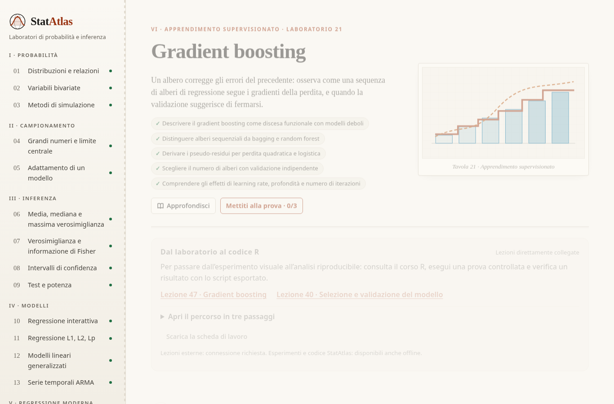

<p align="center">
  
</p>

<h1 align="center">StatAtlas</h1>

<p align="center"><em>Vedere la statistica mentre accade.</em></p>

<p align="center">
  Atlante interattivo di probabilità, inferenza, modelli statistici, machine learning e statistica spaziale.<br>
  <strong>31 laboratori · 93 sfide · 31 script R · un solo file HTML utilizzabile offline.</strong>
</p>

<p align="center">
  <a href="https://gianluca-sottile.github.io/statatlas/"><strong>Apri StatAtlas</strong></a>
  · <a href="#i-laboratori">Laboratori</a>
  · <a href="#per-i-docenti">Docenti</a>
  · <a href="#riproducibilità-in-r">R</a>
  · <a href="#sviluppo">Sviluppo</a>
  · <a href="README.en.md">English</a>
</p>

<p align="center">
  
  
  
  
</p>

## Che cos'è

StatAtlas è un ambiente di apprendimento *esperienziale*: lo studente formula una previsione, modifica i parametri di un esperimento, osserva i risultati e li confronta con la teoria. Non richiede server né account.

- **31 laboratori in otto parti**, dalle distribuzioni alla geostatistica, con teoria a due livelli (*Essenziale*, *Avanzato*), esercizi e bibliografia.
- **93 Challenges** (Comprensione, Applicazione, Avanzato) basate su attività sperimentali reali.
- **Esperimenti riproducibili:** seed controllato, Salva/Apri JSON, Copia link, esportazione dello script R dell'esperimento corrente.
- **Bilingue IT/EN** e collegato al corso [From Data to Models with R](https://gianluca-sottile.github.io/An-R-Tutorial-for-Beginners/).
- **Offline:** `index.html` contiene tutto; solo i link al corso richiedono connessione.



## I laboratori

| | Laboratorio | Che cosa si esplora |
|---|---|---|
| **I · Probabilità** | 01 · Distribuzioni e relazioni | 17 leggi, densità e ripartizione, banda DKW, superfici 3D, mappa dei legami tra leggi |
| | 02 · Variabili bivariate | Nuvola con marginali, densità 3D, leggi condizionate, il limite della correlazione |
| | 03 · Metodi di simulazione | Metodo di inversione, integrazione Monte Carlo, confronto delle varianze |
| **II · Campionamento** | 04 · Grandi numeri e limite centrale | Traiettorie della media, medie standardizzate, Berry–Esseen, il controesempio di Cauchy |
| | 05 · Adattamento di un modello | QQ plot con banda esatta, test X² con classi corrette, p-value Monte Carlo |
| **III · Inferenza** | 06 · Media, mediana e massima verosimiglianza | Efficienza e robustezza sugli stessi campioni (Normale, Laplace, Cauchy) |
| | 07 · Verosimiglianza e informazione di Fisher | Dieci modelli, identità di Bartlett, Cramér–Rao, Wald contro rapporto di verosimiglianza |
| | 08 · Intervalli di confidenza | Copertura nominale, esatta e osservata: Z, t, Wald, Wilson, Garwood, pivot χ² |
| | 09 · Test e potenza | Errore di primo tipo, curve di potenza, numerosità campionaria |
| **IV · Modelli** | 10 · Regressione interattiva | Punti trascinabili, leverage, distanza di Cook, banda per la media e intervallo di previsione |
| | 11 · Regressione L1, L2, Lp | Criteri di stima a confronto con errori a code pesanti e contaminati |
| | 12 · Modelli lineari generalizzati | Logistica e Poisson, IRLS, distorsione per n piccolo, separazione |
| | 13 · Serie temporali ARMA | ACF e PACF teoriche ed empiriche, radici, stazionarietà e invertibilità |
| **V · Regressione moderna** | 14 · Regressione quantilica | Rette per ogni quantile, perdita asimmetrica, soluzione esatta |
| | 15 · Ridge, lasso ed elastic net | Spazio delle soluzioni, percorsi di regolarizzazione, distorsione–varianza |
| | 16 · Regressione non parametrica e spline | Polinomi, spline, P-spline e kernel, gradi di libertà effettivi, validazione incrociata |
| | 17 · Regressione segmentata e breakpoint | Profilo RSS(ψ), breakpoint non identificato, test bootstrap |
| **VI · Apprendimento supervisionato** | 18 · Validazione e overfitting | Training, test e validazione incrociata a K fold |
| | 19 · k vicini più prossimi | Frontiere di decisione, errore di Bayes, limite di Cover–Hart, scelta di k |
| | 20 · Alberi, bagging e random forest | Instabilità di un albero, errore out-of-bag, decorrelazione con mtry |
| | 21 · Gradient boosting | Alberi sequenziali su pseudo-residui, shrinkage, early stopping |
| | 22 · Reti neurali e backpropagation | Rete 2–H–1, forward pass, backpropagation e gradient checking |
| **VII · Riduzione dimensionale e clustering** | 23 · Componenti principali | Scree plot, biplot, ricostruzione, stabilità degli assi |
| | 24 · k-means e clustering gerarchico | Algoritmo di Lloyd, minimi locali, dendrogrammi, indice di Rand corretto |
| | 25 · DBSCAN e confronto tra metodi | Core, bordo e rumore, scelta di ε, confronto con k-means e Ward |
| **VIII · Statistica spaziale** | 26 · Autocorrelazione spaziale e Moran | Punti modificabili, heatmap e Moran globale con vicini kNN |
| | 27 · Autocorrelazione locale, hotspot e MAUP | Quadranti LISA descrittivi HH/LL/HL/LH |
| | 28 · Processi puntuali spaziali | Eventi trascinabili, KDE e curva L(r)−r |
| | 29 · Variogrammi e campi aleatori | Semivarianze empiriche e superficie IDW illustrativa |
| | 30 · Kriging e disegno dei sensori | Ordinary kriging, posizionamento dei sensori, varianza condizionale |
| | 31 · Regressione spaziale | OLS Y~X contro Y~X+coordinate, validazione geografica |

Ogni laboratorio segue lo schema *domanda → previsione → esperimento → confronto con la teoria → interpretazione → Riproduci in R*. Nei laboratori 01–25 la velocità di simulazione si regola con un cursore 0–100; nei laboratori 01–09 la numerosità arriva fino a n = 100.000.

## Per i docenti

- **StatAtlas for Teachers:** costruisce percorsi di 1–24 attività scegliendo laboratori, Challenges, consegne e configurazioni salvate. Esporta un progetto docente (JSON, modificabile) e una pagina studenti HTML autonoma. Nessun dato viene raccolto online. Guida: [docs/TEACHERS_GUIDA_PRATICA_IT_EN.md](docs/TEACHERS_GUIDA_PRATICA_IT_EN.md).
- **Materiali per il corso R:** [guida docente e rubriche](docs/MACROFASE_B_GUIDA_DOCENTE.md), [mappatura laboratorio–lezione](docs/MACROFASE_B_MAPPATURA_CORSO.csv), [31 schede studente](docs/schede_studenti_B/).
- **In aula:** proietta l'esperimento, chiedi una previsione e confronta l'esito con la teoria.

## Riproducibilità in R

Il generatore pseudo-casuale riproduce in JavaScript il Mersenne–Twister e l'inversione normale di R. Ogni laboratorio esporta uno script R con i parametri correnti. Tutti i 31 script sono eseguiti in GNU R, e per i laboratori 01–25 esistono 84 confronti numerici R/JavaScript sugli scenari iniziali. Le verifiche teoriche sono documentate nell'[audit formale](docs/AUDIT_FORMALE_TEORICO_31.md) e nella [matrice delle verifiche](docs/MACROFASE_A_MATRICE_VERIFICHE.csv).

Limiti dichiarati: i quadranti LISA non sono p-value locali, la curva L(r)−r non è da sola un test CSR, la superficie IDW non fornisce una varianza di kriging; le verifiche automatiche di accessibilità non sono una certificazione WCAG.

## Sviluppo

HTML, CSS e JavaScript nativi, senza framework né backend. `build.py` unisce `src/` nell'unico `index.html`.

```bash
python3 build.py                                  # ricostruisce index.html
for f in tests/test_*.js; do node "$f" || exit 1; done
Rscript verifica/valida_tutti_31.R --timeout=900  # validazione completa in R
sh tests/run_macrofase_UX.sh                      # collaudo completo (R, Playwright, Node)
```

Il workflow [StatAtlas QA](.github/workflows/scientific-qa.yml) esegue build e test JavaScript a ogni push; i test completi si avviano a mano da *Actions*. Cronologia: [CHANGELOG.md](CHANGELOG.md).

## Citazione e licenze

**Autore:** Gianluca Sottile, Università degli Studi di Palermo. Metadati: [CITATION.cff](CITATION.cff).

> Sottile, G. (2026). *StatAtlas: un atlante interattivo di probabilità, inferenza, machine learning e statistica spaziale*. https://github.com/gianluca-sottile/statatlas

Ispirato in parte a [Simul2000 di Marcello Chiodi](https://github.com/marcellochiodi/simul2000).

- **Software:** [MIT](LICENSE)
- **Materiali didattici:** [CC BY 4.0](https://creativecommons.org/licenses/by/4.0/deed.it)
