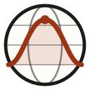

<p align="center">
  
</p>

<h1 align="center">StatAtlas</h1>

<p align="center">
  <em>Vedere la statistica mentre accade.</em><br>
  Un atlante interattivo di probabilità e inferenza statistica: tredici laboratori, dati generati sotto i tuoi occhi e codice R che riproduce esattamente lo stesso esperimento.
</p>

<p align="center">
  <a href="https://gianluca-sottile.github.io/statatlas/"><strong>Apri StatAtlas →</strong></a>
  &nbsp;·&nbsp; <a href="#i-laboratori">Laboratori</a>
  &nbsp;·&nbsp; <a href="#come-è-fatto-un-laboratorio">Struttura</a>
  &nbsp;·&nbsp; <a href="#riproducibilità-in-r">Riproducibilità in R</a>
  &nbsp;·&nbsp; <a href="#sviluppo">Sviluppo</a>
</p>

<p align="center">
  
  
  
  
  
</p>

---

## Perché StatAtlas

Molti concetti della statistica — la legge dei grandi numeri, il teorema centrale, la copertura di un intervallo, la potenza di un test — sono affermazioni su **che cosa succede ripetendo un esperimento molte volte**. StatAtlas rende visibile proprio questo: ogni osservazione, ogni campione, ogni intervallo viene generato davanti allo studente, e il risultato si confronta passo dopo passo con ciò che la teoria garantisce.

- **Didattica attiva.** Ogni laboratorio parte da una domanda e chiede una previsione *prima* di mostrare i dati.
- **Rigore dichiarato.** Ogni risultato teorico è etichettato come *esatto*, *asintotico*, *approssimato* o *Monte Carlo*: non si confonde mai ciò che vale per ogni n con ciò che vale al limite.
- **Stessi numeri in R.** Il generatore di numeri casuali di R è reimplementato nel browser: lo script fornito, con lo stesso seed, riproduce gli stessi campioni.
- **Due livelli di lettura.** Un pannello *Approfondisci* con teoria essenziale, derivazioni avanzate, esercizi con soluzione e bibliografia.
- **Nessuna installazione.** Un unico file `index.html`, che funziona anche offline. Nessun server, nessuna libreria esterna.

## I laboratori

| | Laboratorio | Che cosa si esplora |
|---|---|---|
| **I · Probabilità** | 01 · Distribuzioni e relazioni | 17 leggi, densità e ripartizione, banda DKW, superfici 3D, mappa dei legami tra leggi |
| | 02 · Variabili bivariate | Nuvola con marginali, densità 3D, leggi condizionate, il limite della correlazione |
| | 03 · Metodi di simulazione | Metodo di inversione, integrazione Monte Carlo, confronto delle varianze |
| **II · Campionamento** | 04 · Grandi numeri e limite centrale | Traiettorie della media, medie standardizzate, Berry–Esseen, il controesempio di Cauchy |
| | 05 · Adattamento di un modello | QQ plot con banda esatta, test X² con classi corrette, p-value Monte Carlo |
| **III · Inferenza** | 06 · Media, mediana e massima verosimiglianza | Efficienza e robustezza sugli stessi campioni (Normale, Laplace, Cauchy) |
| | 07 · Verosimiglianza e informazione di Fisher | Dieci modelli, identità di Bartlett, Cramér–Rao, Wald contro rapporto di verosimiglianza |
| | 08 · Intervalli di confidenza | Copertura nominale, esatta e osservata: Z, t, Wald, Wilson, Garwood, pivot χ² |
| | 09 · Test e potenza | Errore di primo tipo, curve di potenza, numerosità campionaria |
| **IV · Modelli** | 10 · Regressione interattiva | Punti trascinabili, leva, distanza di Cook, banda per la media e intervallo di previsione |
| | 11 · Regressione L1, L2, Lp | Criteri di stima a confronto con errori a code pesanti e contaminati |
| | 12 · Modelli lineari generalizzati | Logistica e Poisson, IRLS, distorsione per n piccolo, separazione |
| | 13 · Serie temporali ARMA | ACF e PACF teoriche ed empiriche, radici, stazionarietà e invertibilità |

## Come è fatto un laboratorio

Ogni laboratorio segue la stessa sequenza, così lo studente impara un’unica interfaccia:

1. **Domanda** — un problema concreto da cui partire, con una *previsione facoltativa*: chi vuole mettersi alla prova annota che cosa si aspetta e riceve un riscontro a simulazione avanzata.
2. **Esperimento** — controlli per seed, numerosità, velocità; avvio, pausa, un passo alla volta. Un riquadro spiega *che cosa stiamo valutando*.
3. **Teoria e simulazione a confronto** — una tabella con il valore teorico, quello simulato e la natura del risultato.
4. **Interpretazione** — che cosa significa, quando vale, dove si rompe.
5. **Approfondisci** — Essenziale · Avanzato · Esercizi · Bibliografia.
6. **Codice R** — uno script tidyverse che si aggiorna con i parametri scelti; si copia o si scarica.

I dati e le figure si esportano in CSV e PNG.

## Riproducibilità in R

StatAtlas implementa in JavaScript il generatore **Mersenne-Twister** di R, incluso lo “scrambling” iniziale di `set.seed()`, e il metodo di **inversione** usato da `rnorm()`. Le altre leggi sono generate come `q*(runif(n), …)`, cioè per inversione della funzione di ripartizione. Di conseguenza, con R ≥ 4.1 e le impostazioni predefinite (`RNGkind("Mersenne-Twister", "Inversion")`):

```r
set.seed(2026)
runif(3)   # gli stessi tre numeri che StatAtlas genera con seed 2026
```

Gli script richiedono R ≥ 4.1 e il pacchetto `tidyverse`; alcuni laboratori usano solo funzioni di base di R (`persp`, `glm`, `arima`).

## Uso

- **Online:** apri il sito pubblicato con GitHub Pages.
- **Offline:** scarica `index.html` e aprilo con un browser recente (Chrome, Edge, Firefox, Safari). Funziona anche senza connessione.
- **In aula:** il tema scuro si attiva dalla barra laterale; i grafici si ingrandiscono con la finestra del browser. Tastiera: <kbd>Spazio</kbd> avvia o mette in pausa, <kbd>→</kbd> esegue un passo.

## Sviluppo

Il progetto è scritto in HTML, CSS e JavaScript nativi, senza framework. I sorgenti sono modulari; uno script Python li riunisce nel file unico distribuito.

```
StatAtlas/
├── index.html            ← file distribuito (generato)
├── build.py              ← src/ → index.html
├── src/
│   ├── shell.html
│   ├── styles/           ← design system: token, componenti, strato editoriale
│   ├── core/             ← generatore compatibile con R, leggi, grafici SVG e 3D,
│   │                       componenti, illustrazioni, contenuti didattici, navigazione
│   └── labs/             ← un file per laboratorio
├── tests/
│   ├── test_core.js      ← test numerici contro valori di riferimento di R
│   └── smoke/            ← test di caricamento dei laboratori (jsdom)
└── assets/logo.svg
```

```bash
python3 build.py                                   # ricostruisce index.html
node tests/test_core.js                            # test numerici
npm install jsdom && node tests/smoke/smoke_fase7.js index.html   # smoke test
```

### Verifiche

- 49 test numerici superati: generatore (`runif`, `rnorm`), quantili e funzioni di ripartizione (`qnorm`, `pt`, `qbeta`, `qf`, `qgamma`, …) confrontati con R.
- Smoke test di tutti i laboratori; contrasto dei colori conforme a WCAG 2.1 AA.
- Da completare: esecuzione sistematica degli script R e collaudo su Safari, Firefox e dispositivi mobili.

## Come citare

> Sottile G. (2026). *StatAtlas: un atlante interattivo di probabilità e inferenza statistica*, versione 1.2.0. https://github.com/gianluca-sottile/statatlas

## Crediti

Progetto di **Gianluca Sottile**, Università degli Studi di Palermo.

Diversi laboratori traggono ispirazione dalle idee didattiche di **Simul2000** di Marcello Chiodi (Università di Palermo), in particolare l’attenzione al processo di simulazione osservabile. Codice, testi e illustrazioni di StatAtlas sono originali.

## Licenza

- **Codice** (file `.js`, `.css`, `.html`, `.py`): [licenza MIT](LICENSE).
- **Contenuti didattici** (testi, esercizi, illustrazioni): [Creative Commons Attribuzione 4.0 Internazionale (CC BY 4.0)](https://creativecommons.org/licenses/by/4.0/deed.it).

Puoi usare, modificare e ridistribuire StatAtlas, anche nei tuoi corsi, citando l’autore.
