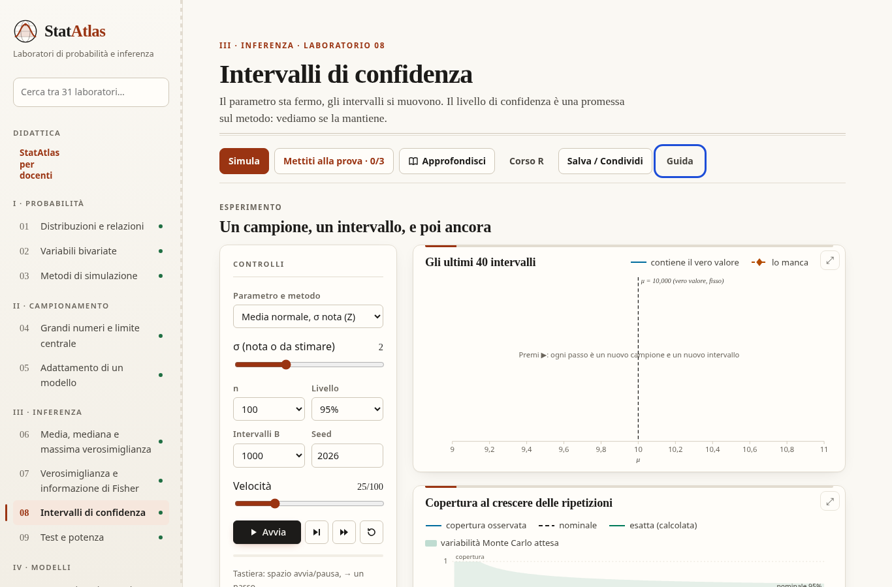
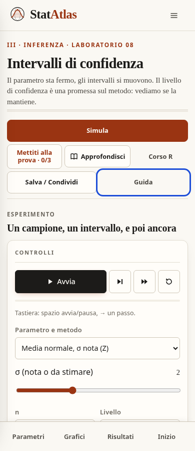
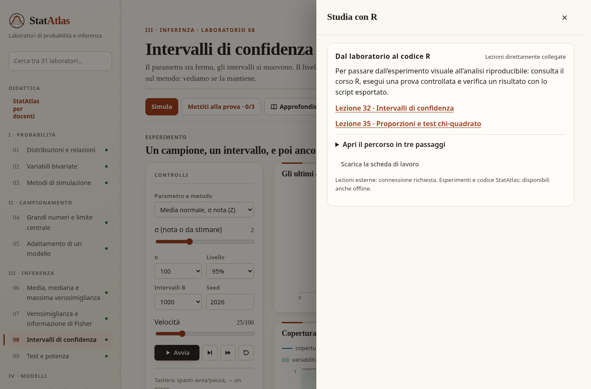
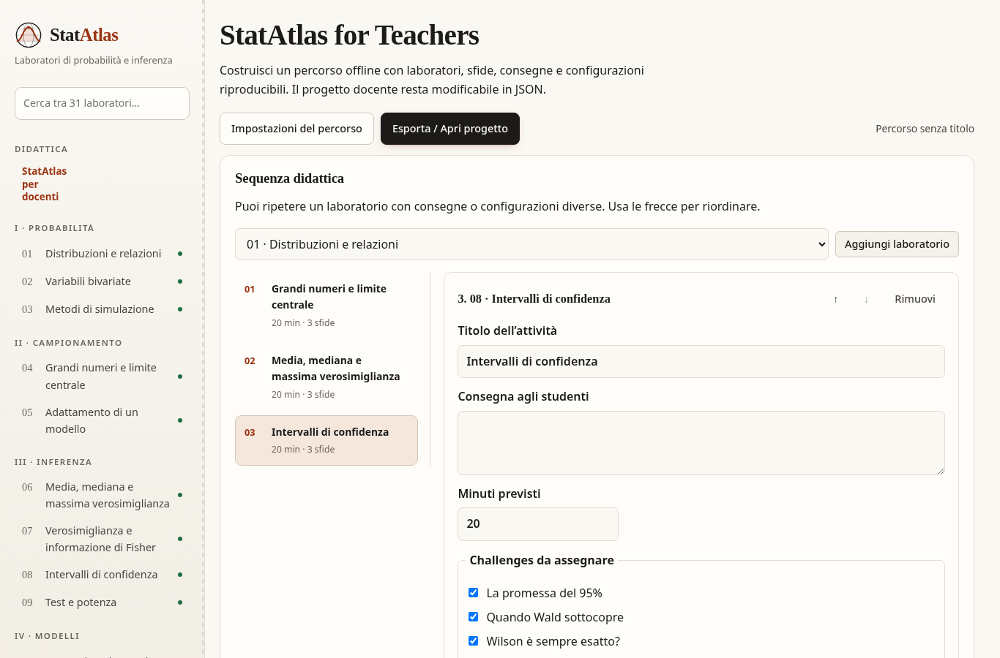
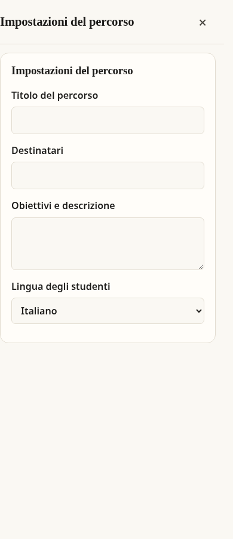
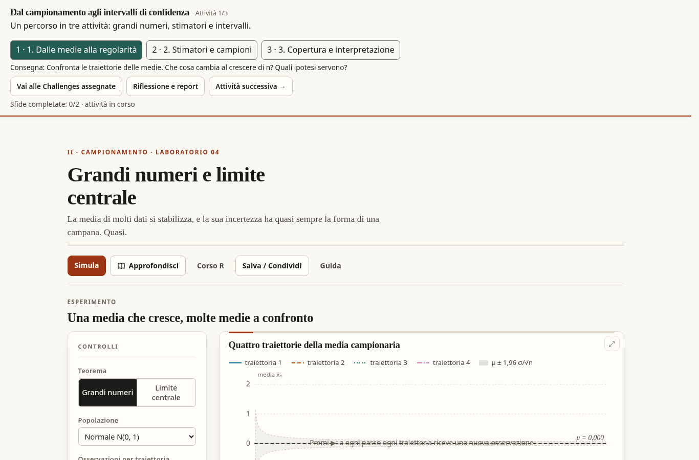
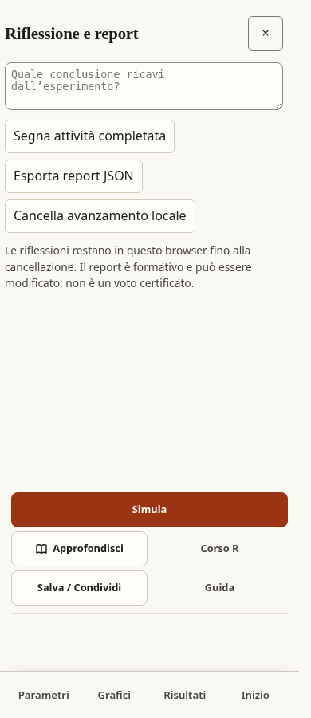

# StatAtlas 2.1 — Relazione di redesign dell'interfaccia

**17 novembre 2026 · Candidate locale UX, non ancora pubblicata**

## Motivazione e risultato

Le funzioni introdotte dalle macrofasi C/D/E (guide, teoria bilingue, 93 Challenges, collegamenti R, esportazione e importazione di esperimenti, authoring docente, report formativo) apparivano simultaneamente nella pagina e ritardavano l'accesso ai controlli del simulatore. La riprogettazione ha mantenuto ogni funzionalità ma imposto una nuova gerarchia: **prima l'esperimento, poi la documentazione e gli strumenti**.

### Prima / dopo: laboratorio 08

Le misure precedenti alla riprogettazione su una viewport campione indicavano l'inizio della simulazione intorno a 1850 px (1366px desktop) e 2393 px (390px mobile); i test attuali verificano per tutti i laboratori una posizione iniziale inferiore a 1000 px, e nelle schermate di riferimento del lab 08 intorno a 420 px e 515 px. I valori sono descrittivi del browser e delle viewport testate, non una metrica universale per ogni browser e impostazione di zoom.

### Teacher e Student

L'editor docente sostituisce la lunga lista di moduli aperti con un indice ordinato di attività e una scheda attiva. Le impostazioni del percorso, il JSON modificabile e l'export HTML sono in pannelli fixed. Nel percorso studente, il diario formativo e il report sono accessibili senza spostare la simulazione. L'anteprima delle impostazioni rimane bilingue e conserva gli input originali.

## File interessati

- `src/core/workbench.js`, `src/styles/workbench.css` — nuova presentazione scientific-first, ricerca catalogo e pannelli contestuali;
- `src/core/app.js`, `build.py` — integrazione della vista e lifecycle di routing;
- `src/core/teachers.js`, `src/styles/teachers.css` — editor master-detail e report studente in drawer;
- test browser A–E aggiornati ai nuovi punti di apertura mantenendo le aspettative scientifiche;
- `tests/test_UX_workbench.py`, `tests/test_UX_contract.js`, `tests/run_macrofase_UX.sh` — nuovi gate UX;
- `scripts/pubblica_github.sh` — blocco del push senza collaudo UX sulla stessa build;
- `examples/E_progetto_campionamento.json`, `examples/E_percorso_campionamento.html` — esempi rigenerati sul nuovo motore.

## Verifiche effettuate nell'ambiente di sviluppo

- 31/31 laboratori e drawer senza reflow a 390 e 1366 px;
- regressioni JavaScript, test scientifici indipendenti e controlli matematici specifici;
- import/export degli esperimenti D e percorsi E con preset, laboratori ripetuti e HTML offline;
- controlli responsive 320/390/768/1024 px, interazioni spaziali e navigazione Challenges;
- esportazione LIVE dei 31 script R, confronto byte per byte con la candidate E: **codici R invariati**;
- snapshot numerici dei primi 25 laboratori, confrontati nei valori con i riferimenti E: **risultati coincidenti**;
- esempio didattico HTML rigenerato e verificato in browser in memoria.

Queste verifiche non attestano l'esecuzione di GNU R sulla **nuova build**: il collaudo `tests/run_macrofase_UX.sh` deve essere eseguito sul Mac, con log allegato, prima di un eventuale GitHub push. Non si rivendica l'equivalenza algoritmica generale R2.

## Evoluzioni successive

La Macrofase F «StatAtlas Classroom» resta **annotata e non avviata**: importazione locale e aggregazione dei report JSON formativi, indicatori di completamento e difficoltà, dashboard privacy-first e offline. Non è una piattaforma d'esame certificativo.
